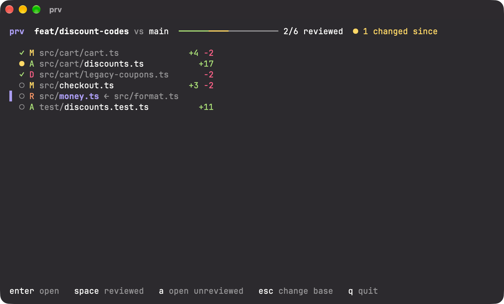
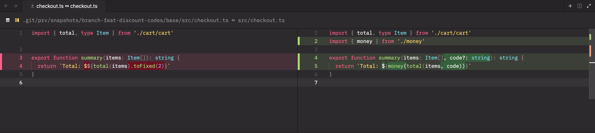
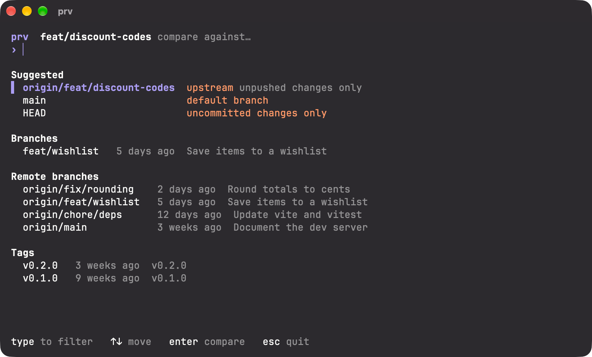

<picture>
  <source media="(prefers-color-scheme: dark)" srcset="assets/logo-dark.png">
  
</picture>

A git diffing tool that gives you powerful context.

Most diff tools show you a patch. PReviewer shows you the code around it: every
file opens as a real diff in your editor with the whole file in view, language
server navigation across the project, and persistent review state that flags
what changed when the branch moves underneath you. Built for reviewing
teammates' PRs and reading end-to-end through what an agent just changed.





Note: We only offer macOS Apple Silicon builds at this time. Diffs are rendered
by [Zed](https://zed.dev), which must be installed along with its `zed` command
(in Zed, run `cli: install` from the command palette).

## Install

```sh
curl -fsSL https://raw.githubusercontent.com/dittofleet/.github/main/install.sh | sh -s sylophi/PReviewer prv
```

Installs the latest release to `~/.local/bin/prv`. Override the install
location with `PRV_INSTALL_DIR`:

```sh
curl -fsSL https://raw.githubusercontent.com/dittofleet/.github/main/install.sh | PRV_INSTALL_DIR=/usr/local/bin sh -s sylophi/PReviewer prv
```

Then run `prv` in any repository to pick what to compare it against, or name a
ref directly, like `prv origin/main`.



## Updating

PReviewer checks for a new release once a day and installs it after you quit.
To update right away:

```sh
prv update
```

`prv uninstall` removes it.

## License

PReviewer is licensed under the MIT License. See [LICENSE](LICENSE).
